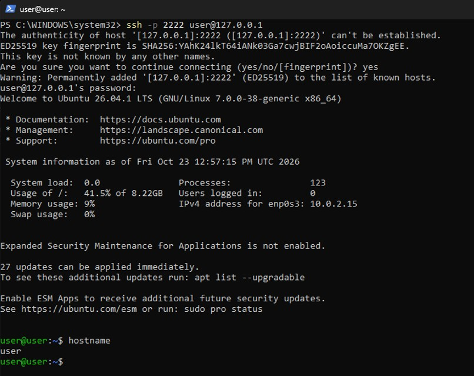
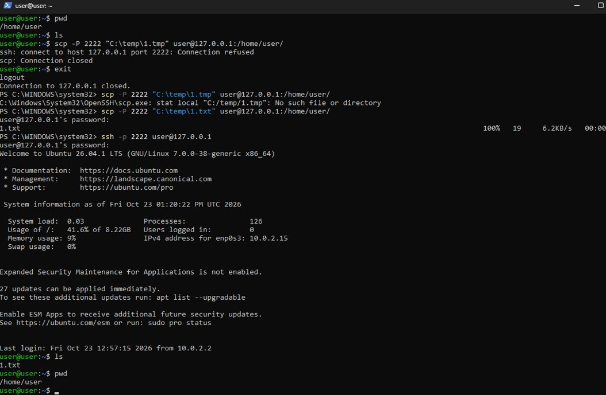
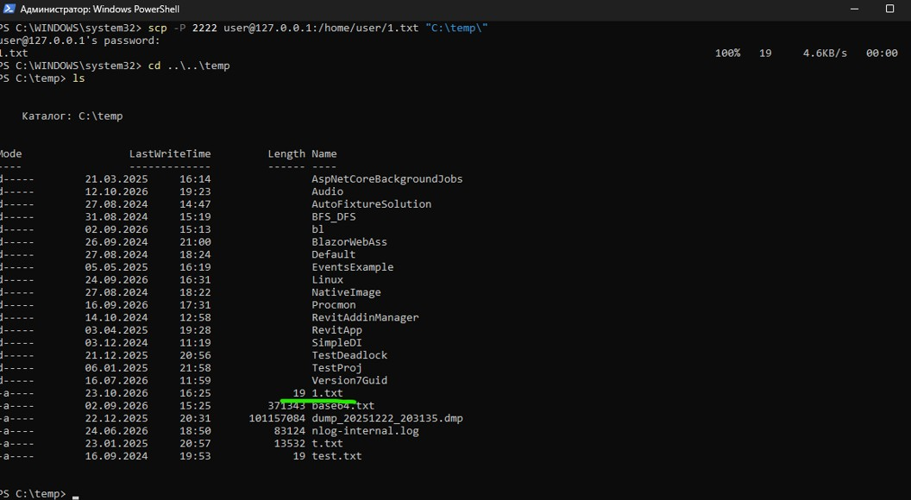
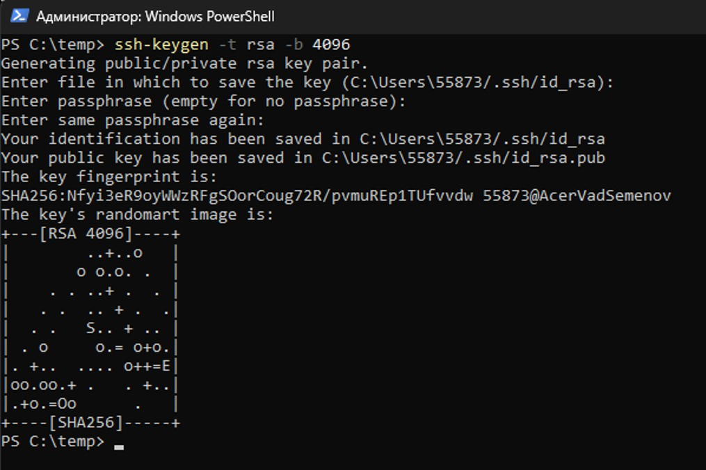
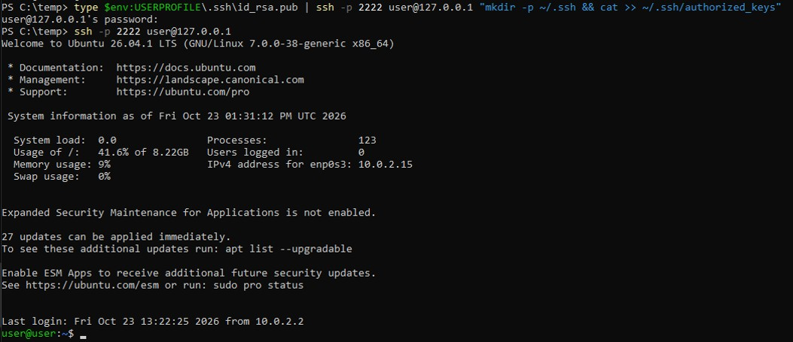

# Программная инженерия
## Домашнее задание 3
## Задание по теме «Работа с серверами и протокол удалённого управления SSH»

В качестве целевой операционной системы используется Ubuntu server установленный на VirtualBox(гостевая ОС), в качестве хоста используется Windows 11(хостовая ОС).
Прокинут порт 22 гостевой ОС на порт 2222 хостовой ОС

### 1. Корректность установки SSH-сервера	(15 баллов)	
**Задание:**
Кейс 1: Установка и настройка SSH-сервера

1. Установить SSH-сервер на виртуальную машину (например, с помощью sudo
apt-get install openssh-server).

2. Настроить SSH-сервер, убедиться, что он запущен, и проверить его статус.
Ожидаемый результат:<br>
● SSH-сервер установлен и запущен.<br>
● Статус SSH-сервера проверен и отображается как "running".

**Выполнение:**

```bash
# Устанавливаем сервер ssh
sudo apt-get install openssh-server
# Запускаем сервер ssh
sudo systemctl start ssh
# Проверяем статус
sudo systemctl status ssh
sudo systemctl enable ssh
# Проверка порта. Проверяем, что сервер слушает стандартный 22-й порт:
sudo ss -tulpn | grep :22
```


**Итог**: Сервер установлен и запущен, статус “running”

### 2. Успешное подключение к серверу	(10 баллов)	
**Задание:** Кейс 2: Подключение к удаленному серверу

1. Использовать команду ssh для подключения к удаленному серверу.

2. Подключиться к серверу с использованием имени пользователя и IP-адреса
(например, ssh user@192.168.1.100).
Ожидаемый результат:<br>
● Успешное подключение к удаленному серверу через SSH.

**Выполнение:**
Подключаемся из хостовой ОС(через PowerShell):

```bash
ssh -p 2222 user@127.0.0.1
```



**Итог**: Возможность подключения по ssh с использованием логина и IP

### 3. Успешное копирование файлов SCP	(10 баллов)	
**Задание:** Кейс 3: Копирование файлов с помощью SCP

1. Использовать команду scpдля копирования файла с локальной машины на удаленный сервер.

2. Копировать файл с удаленного сервера на локальную машину.
Ожидаемый результат:<br>
● Файл успешно скопирован на удаленный сервер и обратно на локальную машину.

**Выполнение:**

```bash
#Копируем с хостовой машины
scp -P 2222 "C:\temp\1.txt" user@127.0.0.1:/home/user/
#...и обратно
scp -P 2222 user@127.0.0.1:/home/user/1.txt "C:\temp\"
```





**Итог**: Файлы успешно переданы и получены обратно

### 4. Генерация ключей и настройка доступа	(15 баллов)	
**Задание:** Кейс 4: Работа с ключами SSH

1. Сгенерировать пару ключей SSH с помощью команды ssh-keygen.

2. Добавить публичный ключ на удаленный сервер для безпарольного входа.

3. Подключиться к серверу с использованием ключей SSH.
Ожидаемый результат:<br>
● Пара ключей SSH сгенерирована.<br>
● Публичный ключ добавлен на удаленный сервер.<br>
● Успешное подключение к серверу без ввода пароля.

**Выполнение:**

```bash
# Cоздание ключа
ssh-keygen -t rsa -b 4096
```



```bash
# Копирование ключа на сервер
type $env:USERPROFILE\.ssh\id_rsa.pub | ssh -p 2222 user@127.0.0.1 "mkdir -p ~/.ssh && cat >> ~/.ssh/authorized_keys"
```

```bash
# Вход по ssh:
ssh -p 2222 user@127.0.0.1
```



**Итог**: Ключи сгенерированы, ключ добавлен на сервер, работает вход без пароля

### 5. Документированность и структурированность отчёта	(10 баллов)

**Ссылка на репозиторий:** [https://github.com/vadsemenov/URFU_Programm_Engineering/](https://github.com/vadsemenov/URFU_Programm_Engineering/) 

**Итог**: README с понятным описанием шагов и ссылкой на репозиторий